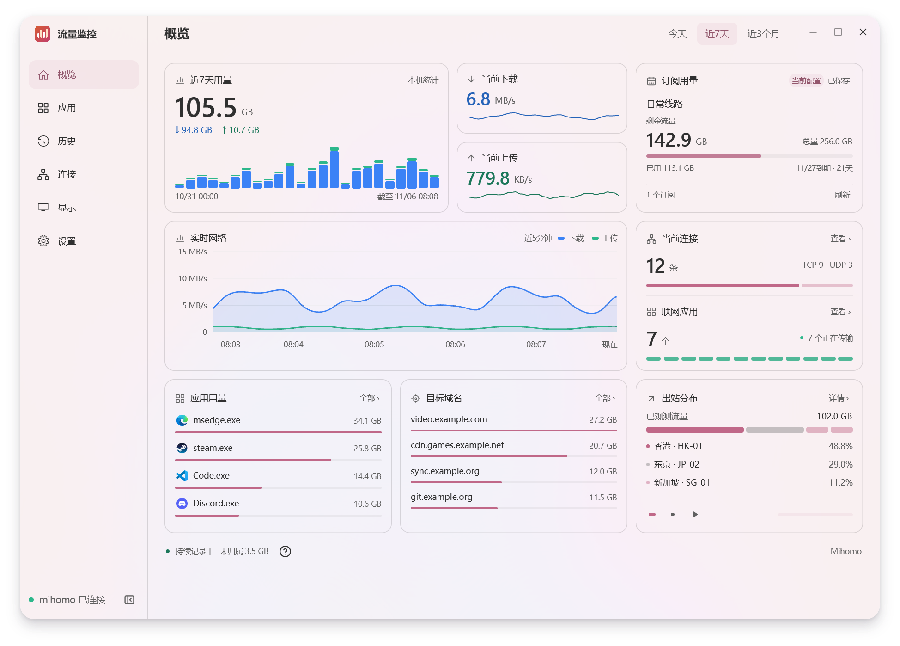
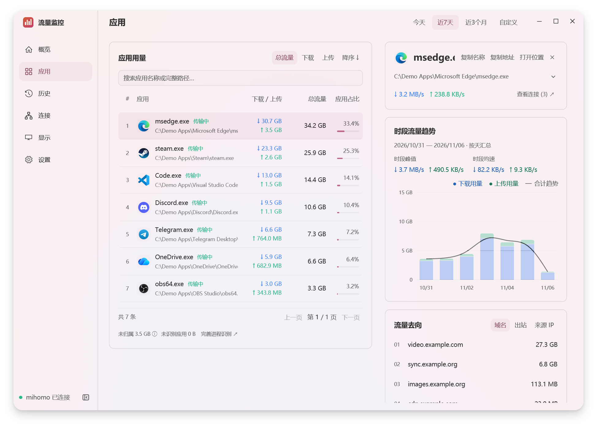
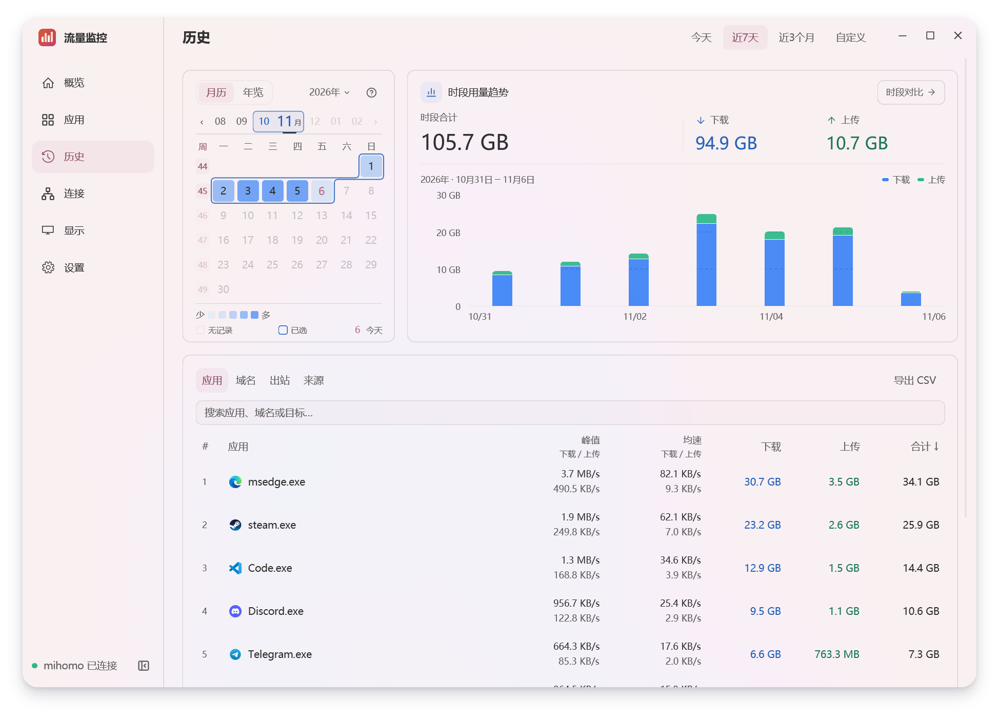
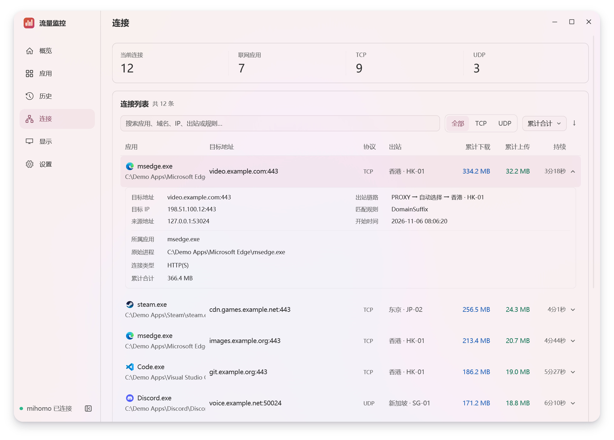
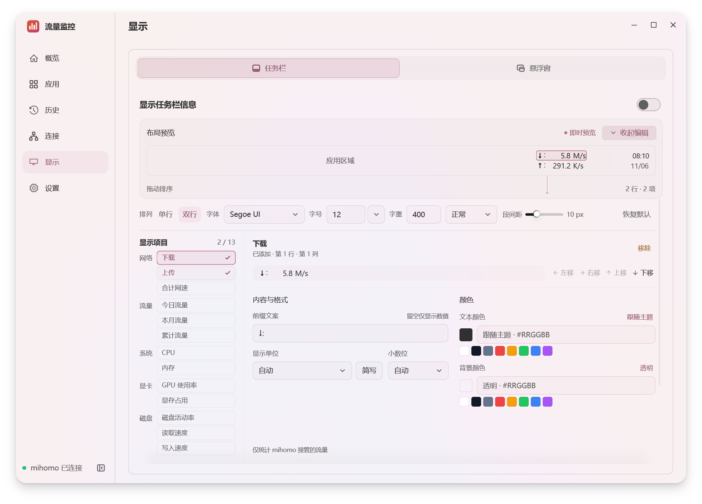
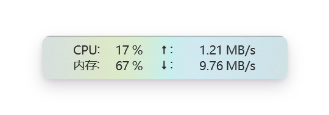
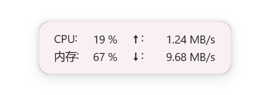

<div align="center">
  <p></p>
  <h1>Mihomo Traffic</h1>
  <p>Windows 上的 Clash-Mihomo 流量账本，随时查看网速、应用用量和历史趋势。</p>
  <p>
    
    <a href="LICENSE"></a>
  </p>
</div>

[](docs/screenshots/overview.png)

## ✨ 功能

- 📊 查看实时网速、当前连接和应用流量排行。
- 📅 按应用、域名或出站翻查历史，比较时段并导出 CSV。
- 🪟 把网速放到任务栏或悬浮窗里，自定义显示内容。
- 💾 流量账本保存在本机，可备份、恢复或迁移。
- 🔌 主要支持 Mihomo 内核，适配 Clash Verge Rev 和 FlClash。其他 Mihomo 客户端可尝试通过本机控制接口手动连接。

## 📸 界面一览

<table>
  <tr>
    <td width="50%" align="center">
      <a href="docs/screenshots/apps.png"></a>
      <br><sub>应用用量</sub>
    </td>
    <td width="50%" align="center">
      <a href="docs/screenshots/history.png"></a>
      <br><sub>历史统计</sub>
    </td>
  </tr>
  <tr>
    <td width="50%" align="center">
      <a href="docs/screenshots/connections.png"></a>
      <br><sub>实时连接</sub>
    </td>
    <td width="50%" align="center">
      <a href="docs/screenshots/display.png"></a>
      <br><sub>桌面显示</sub>
    </td>
  </tr>
  <tr>
    <td width="50%" align="center">
      <a href="docs/screenshots/taskbar.png"></a>
      <br><sub>任务栏</sub>
    </td>
    <td width="50%" align="center">
      <a href="docs/screenshots/floating.png"></a>
      <br><sub>悬浮窗</sub>
    </td>
  </tr>
</table>

## 🚀 安装与连接

1. 在 Windows x64 上下载 **安装版**（`*-setup.exe`）并运行，或解压 **便携版**（`*-portable.zip`）后运行 `mihomo-traffic.exe`。
2. 启动你的 Mihomo 代理客户端，再打开 Mihomo Traffic。软件会尝试自动连接本机内核。
3. 自动连接失败时，打开 **设置 → mihomo连接**，填写客户端的本机控制地址（例如 `http://127.0.0.1:9090`）和 Secret，然后点 **应用并连接**。

## 🛠 从源码启动

在 Windows 上安装 Rust、Visual Studio C++ Build Tools（含 Windows SDK）和 CMake，然后在仓库目录运行下面的命令。

```powershell
cargo run --locked
```

## 📚 文档

### [使用与数据说明](docs/guide.md)

了解后台运行、流量统计口径、数据存储与隐私。

### [开发与发布检查](docs/release-preparation.md)

查看 Windows 构建命令、代码入口、打包和发布前验证步骤。

[MIT 许可证](LICENSE)
